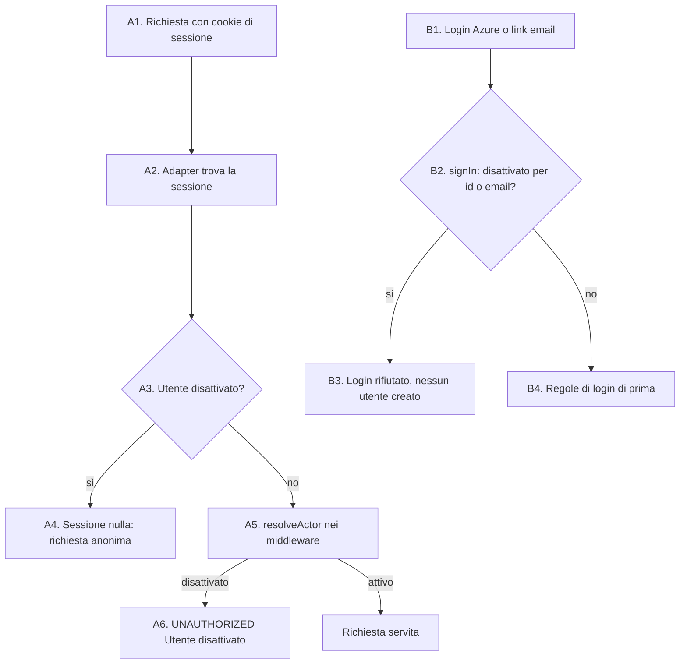

# Accesso di un utente disattivato

Che cosa succede quando un utente disattivato prova a usare il gestionale: con una sessione rimasta, o con un nuovo login. In tutti e due i casi resta fuori, e non nasce un utente nuovo.

- **Attore:** l'utente disattivato. Il sistema: NextAuth v4 (strategy `database`) su Vercel e il backend Hono su Cloud Run.
- **Inizio:** una richiesta con un cookie di sessione, oppure un login con Azure (prod) o con il link email (sviluppo).
- **Esito:** la richiesta vale come anonima (`UNAUTHORIZED` sulle procedure), il login è rifiutato.

Fonte: [[specs/crm/gestione-operatori/SPEC]] (AC16, AC17, AC25).

## Perché è fatta così

- **La disattivazione cancella già le sessioni** ([[domains/crm/flows/disattivazione-operatore]], passo 10). Una sessione può però sopravvivere: un cookie copiato, o una sessione creata in una race con la cancellazione. Questo flusso copre quei casi.
- **Il controllo sta nella lettura della sessione (D8).** Next.js (`getServerSession`: pagine, tRPC in-process, server action) e il backend (`sessionFromRequest` di `apps/api/src/session.ts`) passano tutti e due da `authOptions.adapter.getSessionAndUser`. Un solo punto copre tutto, `protectedProcedure` compresa, che resta com'è.
- **Il login va chiuso prima del ramo prod.** In prod `signIn` accetta chiunque il tenant Azure lasci entrare, e un utente nuovo nasce `ADMIN`. Senza questo controllo un disattivato rientrerebbe, e un utente cancellato rientrerebbe come admin: per questo la spec disattiva invece di cancellare.

## Diagramma

## Passi

### A. Una sessione rimasta

1. **Richiesta** con il cookie `next-auth.session-token`, a una pagina, a tRPC o a un server action su Vercel, oppure al backend su Cloud Run.
2. **L'adapter trova la sessione.** L'override di `getSessionAndUser`, accanto a `createUser` in `auth.ts`, legge la sessione con l'adapter di NextAuth.
3. **Controllo dell'utente.** Legge `users.disabled_at` per chiave primaria (`isUserDisabled`, un servizio in Effect eseguito con `runAuth`). L'adapter è costruito con `pgTableCreator` e non conosce le colonne nuove: è una lettura in più a ogni lettura di sessione, su Vercel e su Cloud Run.
4. **Disattivato → `null`**, come una sessione che non esiste. Ogni `protectedProcedure` risponde `UNAUTHORIZED`.
5. **Difesa in profondità.** `operatorProcedure` e `adminProcedure` passano da `resolveActor` (`services/auth/actor.ts`). Con una sessione già letta, per esempio quella che i test passano direttamente al caller, un utente disattivato riceve `OperatorDisabled`.
6. **`OperatorDisabled` → `UNAUTHORIZED`**, con il messaggio "Utente disattivato".

### B. Un nuovo login

1. **Login** con Azure in prod, o con il link email in sviluppo.
2. **`signIn` controlla il disattivato per primo**, prima del ramo `isProduction → true`. Riconosce l'utente per id, quando NextAuth passa l'utente del database (account collegato), altrimenti per email senza differenze di maiuscole (`lower`, come `matchUserEmail`).
3. **Disattivato → `false`.** NextAuth risponde `AccessDenied` prima di `createUser`: non nasce un utente nuovo. Con il link email, il link non parte. Un errore del database durante il controllo rifiuta il login (review della PR 4).
4. **Non disattivato:** valgono le regole di prima. In prod entra chiunque il tenant lasci entrare; altrove solo gli utenti già nel database e gli indirizzi di `AUTH_ALLOWED_EMAILS`.

## Rami di recupero

- **Riattivazione:** solo a mano sul database (`disabled_at` e `disabled_by` a null, Technical Notes della spec). Dopo, l'utente rientra con un login normale. Il portafoglio non torna.

## Note e debito

- **Costo:** una lettura per chiave primaria in più a ogni lettura di sessione, e in prod `signIn` ora legge il database. È da misurare su staging.
- **Requisito per il sostituto di NextAuth (TD4 di [[chore/migrazione-effect]] §7).** La spec che sostituirà NextAuth deve conservare i due comportamenti di questo flusso, con gli stessi test sull'adapter e su `sessionFromRequest`.
- **OQ2 della spec, aperta:** oggi chi entra dal tenant Azure nasce `ADMIN`. Questo flusso tiene fuori i disattivati, ma non decide chi diventa admin.

## Riferimenti

- Spec: [[specs/crm/gestione-operatori/SPEC]]; note: [[specs/crm/gestione-operatori/IMPLEMENTATION-NOTES]]; review: [[specs/crm/gestione-operatori/REPORT]] (PR 4, autenticazione e autorizzazione).
- Codice: `packages/server/src/auth.ts` (`signIn`, override di `getSessionAndUser`); `packages/server/src/services/auth/{disabled,actor}.ts`; `apps/api/src/session.ts`.
- Concetto: [[domains/crm/concepts/operatore]].
