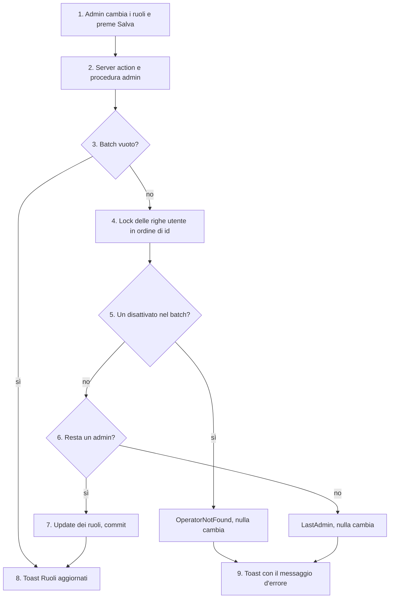

# Cambio di ruolo degli operatori

Un admin cambia il ruolo (`ADMIN` o `OPERATORE`) di uno o più operatori dalla tabella admin e salva tutto insieme. Il server applica il batch per intero o lo rifiuta per intero.

- **Attore:** un admin, dalla tabella admin del profilo (`/dashboard/profile`, tab admin).
- **Inizio:** i select dei ruoli e il bottone "Salva".
- **Esito:** i ruoli sono cambiati e resta almeno un admin, oppure non cambia nulla e l'admin vede perché.

Fonte: [[specs/crm/gestione-operatori/SPEC]] (AC18–AC20a), con le deviazioni di [[specs/crm/gestione-operatori/IMPLEMENTATION-NOTES]].

## Perché è fatta così

- **"Mai l'ultimo admin" sta qui.** La disattivazione tocca solo gli `OPERATORE` ([[domains/crm/flows/disattivazione-operatore]]), quindi non può togliere l'ultimo admin. L'unico modo di restare senza admin è declassarlo. Prima di questa spec `updateOperatorsRole` non aveva guard: si poteva declassare l'ultimo admin, anche sé stessi.
- **Una transazione per il batch.** Prima gli update erano uno per uno, fuori transazione: un errore a metà lasciava metà batch applicato. Il conteggio degli admin ha comunque bisogno della transazione e dei lock, quindi il batch è diventato atomico nella stessa PR (la 4, non la 2, che doveva essere un refactor puro: D10).
- **Gli errori arrivano all'admin.** Prima la tabella mostrava il toast di successo anche quando il server action falliva.

## Diagramma

## Passi

1. **L'admin cambia i ruoli** nei select della tabella. Le modifiche restano in uno store del client finché non preme "Salva".
2. **Server action `updateOperatorsRole`** → procedura `operator.updateOperatorsRole`, una `adminProcedure`: chi non è admin riceve `FORBIDDEN`.
3. **Un batch vuoto** riesce senza toccare il database.
4. **Lock.** In un solo statement, in ordine di `users.id`, `FOR UPDATE OF users`: le righe degli admin attivi e quelle degli operatori del batch. L'ordine per id evita il deadlock fra due batch. La disattivazione blocca la stessa riga utente, quindi un cambio di ruolo e una disattivazione dello stesso utente non passano tutti e due su un `disabled_at` vecchio. Vedi [[domains/crm/concepts/regola-dei-lock]].
5. **Disattivati e id sconosciuti.**
   - Un operatore disattivato nel batch → `OperatorNotFound`, e non cambia nulla dell'intero batch.
   - Un id senza operatore viene saltato senza errore, come prima della spec. Si cambia solo quello che serve (D7).
   - Se un id compare più volte, vale la prima modifica.
6. **Conteggio degli admin dopo il cambio.** Contano solo gli `ADMIN` non disattivati **con una riga operatore**. Se sono zero → `LastAdmin` ("Deve restare almeno un admin"), e non cambia nulla.
   - **Deviazione dalla spec** (review della PR 4): AC18 parla di "nessun `ADMIN` non disattivato". Un utente `ADMIN` senza operatore però non passa da `adminProcedure`, quindi non può amministrare nulla e non tiene in vita il vincolo.
7. **Update dei ruoli** nell'ordine del batch, poi commit.
8. **Successo:** toast "Ruoli aggiornati" e modifiche in sospeso svuotate.
9. **Errore:** toast con il messaggio. Per un codice di dominio è il suo messaggio italiano (`LAST_ADMIN` → "Deve restare almeno un admin"); per tutto il resto "Errore durante l'aggiornamento dei ruoli". Le modifiche in sospeso restano, così l'admin le può correggere.

## Rami d'errore e di recupero

- **Il server action non lancia:** restituisce `{ error: code }`, perché in produzione Next.js toglie il messaggio di un errore lanciato. Il codice si legge in tutte e due le forme dell'errore, in-process e via `BACKEND_URL`.
- **Chiamata rifiutata** (rete, timeout): toast generico, e il bottone esce dallo stato di caricamento.
- **Due admin che si declassano a vicenda nello stesso momento:** il secondo aspetta il lock del primo, poi conta. Uno riesce, l'altro riceve `LastAdmin`. Alla fine c'è un admin.
- **Un operatore disattivato mentre la sua modifica è in sospeso:** la disattivazione la toglie dallo store, e le modifiche di righe sparite non si mandano. Altrimenti il batch verrebbe rifiutato tutto con `OperatorNotFound`.

## Limiti noti

Nel debito, [[tech-debt/crm/gestione-operatori]]:

- **Modifiche di ruolo in sospeso fuori dalla vista.** Lo store è globale: cambiando tab e tornando, "Salva" può mandare modifiche che i select non mostrano. Durante un salvataggio i select restano attivi, e una scelta fatta in quel momento si perde.
- **La lista degli operatori arriva anche agli `OPERATORE`** nel payload della route parallela `@admin`. Le mutazioni restano `adminProcedure`.

## Riferimenti

- Spec: [[specs/crm/gestione-operatori/SPEC]]; note: [[specs/crm/gestione-operatori/IMPLEMENTATION-NOTES]]; review: [[specs/crm/gestione-operatori/REPORT]] (PR 4 per `LastAdmin`, PR 5 per la tabella).
- Codice: `packages/server/src/services/operator/roles.ts`; `src/app/dashboard/profile/@admin/_components/OperatorTable.tsx`; `_actions/updateOperatorsRole.ts`; `_store/useOperatorTableStore.ts`.
- Concetti: [[domains/crm/concepts/operatore]], [[domains/crm/concepts/regola-dei-lock]].
