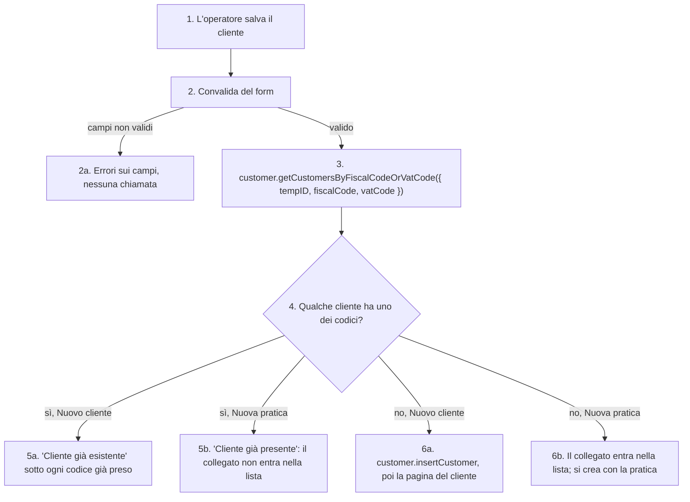

# Controllo dei duplicati di un cliente nuovo

Prima di creare un cliente, la pagina cerca se uno dei suoi codici appartiene già a un altro cliente. Succede in due punti: il form **Nuovo cliente** (`/dashboard/customers/new`) e il cliente collegato (garante, coobbligato…) che si aggiunge in **Nuova pratica** (`/dashboard/customers/<id>/connect`). Il controllo è nel browser: il server non rifiuta un codice fiscale o una partita IVA doppi (solo l'NDG è unico nel database). I codici sono descritti in [[domains/crm/concepts/codici-del-cliente]].

1. **Salvataggio.** In Nuovo cliente è il pulsante "Salva"; in Nuova pratica è il salvataggio della scheda del cliente collegato. Un cliente collegato scelto fra quelli esistenti non passa dal controllo.
2. **Convalida del form.** Nuovo cliente vuole il "Codice Cliente (NDG)", che è il `tempID`, e almeno uno fra codice fiscale (16 caratteri) e partita IVA (11 caratteri).
   - 2a. Con campi non validi non parte nessuna chiamata.
3. **Ricerca.** La query manda i tre codici. Lo schema della procedura toglie gli spazi attorno a codice fiscale e partita IVA, e vuole almeno uno dei due.
4. **Corrispondenza.** Il server trova ogni cliente che ha **uno qualunque** dei codici passati non vuoti. Un codice vuoto non trova nessuno.
5. **Duplicato trovato.**
   - 5a. Nuovo cliente segna "Cliente già esistente" solo sotto i campi il cui codice è già di un cliente, e non chiama `insertCustomer`. Il form confronta i codici con un `trim`, perché il codice fiscale torna dal database con gli spazi del `char(16)`.
   - 5b. Nuova pratica rifiuta il collegato con "Cliente già presente", senza dire quale codice.
6. **Nessun duplicato.**
   - 6a. `customer.insertCustomer` crea il cliente, e la pagina va al suo dettaglio.
   - 6b. Il collegato entra nella lista della pratica. Lo crea `insertCustomer` solo quando si salva la pratica ("Aggiungi Pratica").

## [Source: IMPLEMENTATION-NOTES]

- **Fino al 2026-10-24 la ricerca aveva una priorità**: con un `tempID` non vuoto guardava solo il `tempID`, altrimenti il codice fiscale, altrimenti la partita IVA. Nuovo cliente manda sempre l'NDG, quindi un cliente con il codice fiscale di un altro si creava senza errore (prova nel browser del 2026-10-24). Corretta nella PR del passo 2 di [[chore/migrazione-effect]], in un commit dopo il refactor, su richiesta di Omar; la SPEC metteva le correzioni fuori scope, e il commit si può spostare in una PR sua. Resta in TD8 (b) solo il `refine` che vuole codice fiscale o partita IVA anche quando si cerca per NDG.
- **Provato nel browser** da agent a contesto pulito su `mito_local`. Nuovo cliente: codice fiscale, partita IVA o NDG già presi danno l'errore solo sotto quel campo; codici di due clienti diversi danno l'errore sotto tutti e due; codici nuovi creano il cliente. Nuova pratica: codice fiscale o partita IVA già presi rifiutano il collegato; codici nuovi lo accettano.
- Codice: `packages/server/src/services/customer/queries.ts` (`findCustomersByCode`), `packages/server/src/api/routers/customer/GET/index.ts` (schema dell'input), `src/app/dashboard/customers/new/_components/NewCustomerForm.tsx`, `src/app/dashboard/customers/[id]/connect/_components/NewPraticaForm.tsx`. Test: `packages/server/src/api/routers/customer/_test/queries.db.test.ts`.

## [Source: REPORT]

- La review del refactor (SHIP, critical) è precedente alla correzione: ha verificato la ricerca con la priorità di allora. Vedi [[specs/crm/customer-effect/REPORT]].

Concetti: [[domains/crm/concepts/codici-del-cliente]].
