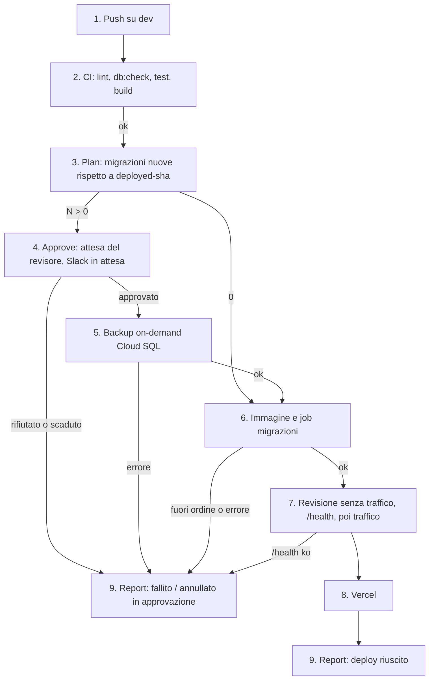

# Deploy di staging

Ogni merge su `dev` porta il backend su Cloud Run e il frontend su Vercel (`.github/workflows/deploy-staging.yaml`). Le migrazioni nuove non toccano il database finché una persona non le approva, e prima di applicarle c'è un backup.

- **Attori:** chi unisce la PR (o lancia il workflow a mano); un revisore dell'environment `staging-db` (Leonardo, Omar).
- **Inizio:** push su `dev`.
- **Esito:** un messaggio in `#deploy` con l'ambiente: riuscito (commit, revisione, migrazioni nuove, backup), fallito o annullato (con la fase).

1. Un merge su `dev` avvia il workflow. La concorrenza `deploy-staging` ne fa girare uno alla volta, senza interromperlo.
2. La CI riusa `ci.yml`. `pnpm db:check` fallisce se il journal ha migrazioni generate sullo stesso snapshot o fuori ordine.
3. **Plan** legge la label `deployed-sha` della revisione che serve tutto il traffico e confronta il journal di quel commit con quello della run. Scrive le migrazioni nuove con il loro SQL nel riepilogo della run. Vedi [[domains/crm/concepts/migrazioni-nuove-del-deploy]].
4. **Approve** parte solo con migrazioni nuove: aspetta un revisore di `staging-db` e Slack riceve "in attesa di approvazione". Un rifiuto, o 30 giorni senza risposta, ferma tutto prima del database.
5. Con migrazioni approvate, `deploy-staging.sh` crea un backup on-demand con descrizione `deploy <sha>`. Se fallisce, il deploy si ferma. Vedi [[domains/crm/concepts/backup-di-deploy]].
6. Il job migrazioni gira con la nuova immagine. Fallisce, senza applicare nulla, se una migrazione mai applicata ha una data compresa tra quelle già applicate (`MigrationOutOfOrder`).
7. La nuova revisione, con label `deployed-sha`, parte senza traffico; se il suo `/health` risponde prende il traffico.
8. Il frontend va su Vercel dopo il backend che chiama.
9. **Report** manda un solo messaggio finale in `#deploy`, qualunque sia l'esito, con la fase in cui si è fermato.

## Ripristino

Se una migrazione approvata ha rovinato i dati: `apps/api/gcp/RESTORE-STAGING.md`, dal Mac. Si ripristina il backup del deploy sulla stessa istanza e si rimette il traffico sulla revisione precedente. Il deploy successivo ripropone le migrazioni da approvare, perché la revisione che serve torna a quella di prima.

## [Source: IMPLEMENTATION-NOTES]

Il primo deploy dopo la #71 non aveva label: ha chiesto di approvare tutte le 12 migrazioni del journal, e il migrator non ne ha applicata nessuna. Da lì in avanti la label c'è su ogni revisione.
