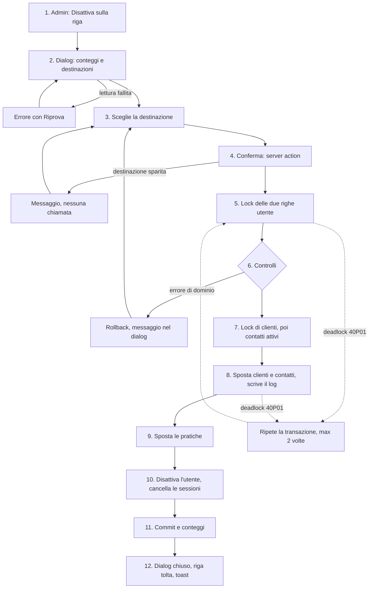

# Disattivazione di un operatore

Un admin toglie un `OPERATORE` dal gestionale e passa il suo portafoglio a un altro operatore, scelto da lui. L'utente non si cancella: si disattiva. Lo storico tiene l'operatore (le FK verso `operators.id` non hanno `ON DELETE`), e un utente cancellato rientrerebbe come `ADMIN` al primo login Azure. Vedi [[domains/crm/concepts/operatore]].

- **Attore:** un admin, dalla tabella admin del profilo (`/dashboard/profile`, tab admin).
- **Inizio:** il bottone "Disattiva" su una riga.
- **Esito:** l'utente è disattivato, le sue sessioni sono cancellate, clienti, contatti attivi e pratiche sono sulla destinazione, e ogni spostamento di cliente e contatto ha la sua riga di log. Oppure non cambia nulla.

Fonte: [[specs/crm/gestione-operatori/SPEC]] (AC1–AC13, AC21–AC23), con le deviazioni di [[specs/crm/gestione-operatori/IMPLEMENTATION-NOTES]].

## Perché è fatta così

- **Una sola transazione.** Tutto o niente: nessun cliente resta senza responsabile a metà strada, e il log non racconta spostamenti che non ci sono stati.
- **Un solo statement per spostamenti e log.** Le CTE di uno statement vedono la stessa fotografia, quindi il log ha una riga per esattamente quello che è stato spostato. Con due statement separati un cliente diventato del disattivato nel mezzo si spostava senza log (review della PR 4, primo giro).
- **Per insiemi di righe.** Un operatore può avere 5.000 clienti e 5.000 contatti attivi (il seed di `mito_local`). Un `VALUES` per riga supera il limite di 65.535 parametri di Postgres. Gli statement usano solo parametri costanti: a quella scala la disattivazione dura meno di mezzo secondo.
- **Prima gli utenti, poi i clienti.** Le assegnazioni verso il disattivato che arrivano nello stesso momento devono finire prima, ed essere spostate, o trovare l'operatore disattivato. Vedi [[domains/crm/concepts/regola-dei-lock]].

## Diagramma

## Passi

1. **"Disattiva" sulla riga.** C'è solo sulle righe `OPERATORE` che non sono l'utente corrente. Un `ADMIN` va prima declassato ([[domains/crm/flows/cambio-ruolo-operatori]]). Il bottone ha il nome accessibile "Disattiva <nome cognome>".
2. **Il dialog si apre** con il titolo "Disattiva <nome cognome>" e il focus sul select della destinazione. Carica due letture `adminProcedure`:
   - `operator.getDeactivationImpact({ operatorId })`: quanti clienti, contatti attivi e pratiche passeranno. Legge senza lock, quindi la disattivazione può spostarne qualcuno in più o in meno;
   - `operator.getOperatorsForDeactivation`: gli operatori attivi tranne lui.

   Se una lettura fallisce, il dialog lo dice e offre "Riprova", invece di restare su "Caricamento...".
3. **L'admin sceglie la destinazione.** "Conferma" resta disabilitato finché non c'è.
4. **Conferma.** Il server action `deactivateOperator` chiama `operator.deactivate({ operatorId, toOperatorId })`. È una `adminProcedure`: chi non è admin riceve `FORBIDDEN` (`admin-only`) e non cambia nulla. Se un refetch ha tolto la destinazione dall'elenco, il dialog lo dice ("L'operatore scelto non è più disponibile: scegline un altro"), azzera la scelta e non chiama il server. Durante l'invio il dialog non si chiude.
5. **Lock delle righe utente.** In un solo statement, in ordine di `users.id`: le righe dell'operatore e della destinazione, `FOR UPDATE OF users`. Mai senza `OF`, che bloccherebbe anche `operators`.
6. **Controlli, in quest'ordine, prima di ogni scrittura.** Il primo che fallisce chiude la transazione senza cambiare nulla:
   - l'operatore esiste, ha un utente e non è già disattivato, altrimenti `OperatorNotFound`. L'operatore di sistema non ha utente, quindi cade qui;
   - non è l'admin che agisce, altrimenti `CannotDeactivateSelf`;
   - non è `ADMIN`, altrimenti `OperatorIsAdmin`;
   - la destinazione è un altro operatore, altrimenti `HandoverSameOperator`;
   - la destinazione lavora (`findWorkingOperator`: esiste, ha un utente, non è disattivata), altrimenti `OperatorNotFound`.
7. **Lock del portafoglio.** In ordine di id, i clienti dell'operatore e quelli con un suo contatto attivo. Poi, in ordine di id, quei contatti attivi.
8. **Spostamento e log, in un solo statement.**
   - I clienti con `operator_id` = disattivato passano alla destinazione.
   - I contatti attivi del disattivato passano all'operatore che il loro cliente ha dopo lo spostamento: il cliente vince, come nella regola "stesso operatore" di [[specs/crm/sezione-contatti/SPEC]]. Quindi alla destinazione se il cliente era del disattivato; all'operatore del cliente se il cliente era di un altro; alla destinazione se il cliente non ha operatore, e il cliente resta senza.
   - Per ogni cliente e contatto spostato si scrive una riga `operator_reassign` in `task_event_log`: `source = 'deactivation'`, `actor_operator_id` = l'admin, `from_operator_id` = il disattivato, `to_operator_id` = l'operatore scritto davvero, `task_id` null per il cliente e l'id del contatto per il contatto. Una fonte di log dedicata, e non `bulk`, fa capire nello storico e nell'export perché il cliente è passato.
   - **Deviazione da AC9:** un contatto attivo senza cliente si sposta alla destinazione e conta in `contactsMoved`, ma non ha riga di log. `task_event_log.customer_id` è NOT NULL, e le migrazioni di questa spec sono solo additive. Accettata da Omar il 2026-10-22; è nel debito, [[tech-debt/crm/gestione-operatori]].
9. **Pratiche.** Ogni pratica del disattivato passa alla destinazione, senza log, come oggi in `pratiche.PUT`.
10. **Utente.** `users.disabled_at = now()`, `users.disabled_by` = l'operatore dell'admin. Le righe `session` dell'utente sono cancellate: è fuori, su Vercel e su Cloud Run, alla richiesta successiva. Cosa succede dopo a una sessione rimasta o a un nuovo login: [[domains/crm/flows/accesso-utente-disattivato]].
11. **Commit e risposta** `{ customersMoved, contactsMoved, practicesMoved }`. Su `deadlock_detected` (40P01) l'intera transazione riparte da capo, al massimo 2 volte. Il deadlock è possibile con il cron `priority`, che sta fuori dalla regola dei lock.
12. **Dopo la conferma.**
    - Il dialog si chiude e la riga sparisce dalla tabella. Il server action fa il revalidate di `/dashboard/profile`: `@admin` è una route parallela, non un segmento dell'URL.
    - Un cambio di ruolo in sospeso per quell'operatore viene tolto dalle modifiche da salvare. Altrimenti il prossimo "Salva" manderebbe un disattivato e il server rifiuterebbe tutto il batch.
    - Un toast riporta i conteggi e il nome della destinazione.
    - Il focus va al titolo della tabella, perché il bottone della riga non esiste più.

## Rami d'errore e di recupero

- **Errore di dominio** (`OPERATOR_IS_ADMIN`, `CANNOT_DEACTIVATE_SELF`, `OPERATOR_NOT_FOUND`, `HANDOVER_SAME_OPERATOR`): il server action restituisce `{ error: code }` e non lancia, perché in produzione Next.js toglie il messaggio di un errore lanciato. Il dialog resta aperto e mostra il messaggio italiano. I codici stanno in `contactErrorCodes` di `@mito/domain`, così si leggono sia in-process sia via `BACKEND_URL`. Messaggi: [[domains/crm/concepts/operatore]].
- **Chiamata rifiutata** (rete, timeout della funzione, action sparita dopo un deploy): messaggio generico, e il dialog torna usabile. Prima della correzione della review della PR 5 restava bloccato.
- **`Esc` o "Annulla":** il dialog si chiude, la scelta si azzera e il focus torna al bottone della riga.
- **Deadlock:** ripetizione automatica (passo 11). Al terzo fallimento l'errore arriva al dialog come errore generico.
- **Disattivazione sbagliata:** dalla UI non si torna indietro. Si riattiva a mano sul database, con l'`update` delle Technical Notes della spec (`disabled_at` e `disabled_by` a null). Il portafoglio non torna indietro.

## Operazioni simultanee (AC7)

Con la [[domains/crm/concepts/regola-dei-lock]] nessuna di queste lascia qualcosa sul disattivato:

- **Due disattivazioni dello stesso operatore:** una riesce, l'altra riceve `OperatorNotFound`.
- **Un cambio di ruolo sullo stesso utente:** blocca la stessa riga `users`, quindi non nasce un `ADMIN` disattivato.
- **Disattivazioni incrociate (X→Y e Y→Z):** o riescono tutte e due e il portafoglio di X finisce su Z, o la seconda riceve `OperatorNotFound`.
- **Un passaggio di consegne, "Assegna Clienti", "Assegna chiamate", "Assegna a te" o una riassegnazione verso X:** o finisce prima, e il suo cliente viene spostato dalla disattivazione, o riceve `OperatorNotFound`. Vale anche per un "Assegna Clienti" lungo già partito, perché il controllo è in ogni transazione per cliente.

## Limiti noti

- **Due scrittori fuori dalla regola:** `pratiche.PUT` e `customer.insertCustomer` non controllano la destinazione. Una loro scrittura confermata dopo la fotografia dello statement del passo 8 resta sul disattivato. Rischio basso, perché le liste della UI non mostrano i disattivati. Nel debito, [[tech-debt/crm/gestione-operatori]].
- **Condizione per la prod:** OQ2 della spec. Oggi chiunque entra dal tenant Azure diventa `ADMIN`, e `operator.deactivate` si chiama anche via HTTP. Va chiusa prima che la funzione arrivi in prod.
- **I filtri sui dati storici** non mostrano più il disattivato (OQ3, nel debito).

## Riferimenti

- Spec: [[specs/crm/gestione-operatori/SPEC]]; note: [[specs/crm/gestione-operatori/IMPLEMENTATION-NOTES]]; review: [[specs/crm/gestione-operatori/REPORT]] (PR 4 e PR 5).
- Codice: `packages/server/src/services/operator/deactivate.ts` (`deactivateOperator`, `deactivationImpact`); `src/app/dashboard/profile/@admin/_components/DeactivateOperatorDialog.tsx`; `_actions/deactivateOperator.ts`.
- Flussi vicini: [[domains/crm/flows/accesso-utente-disattivato]], [[domains/crm/flows/cambio-ruolo-operatori]].
