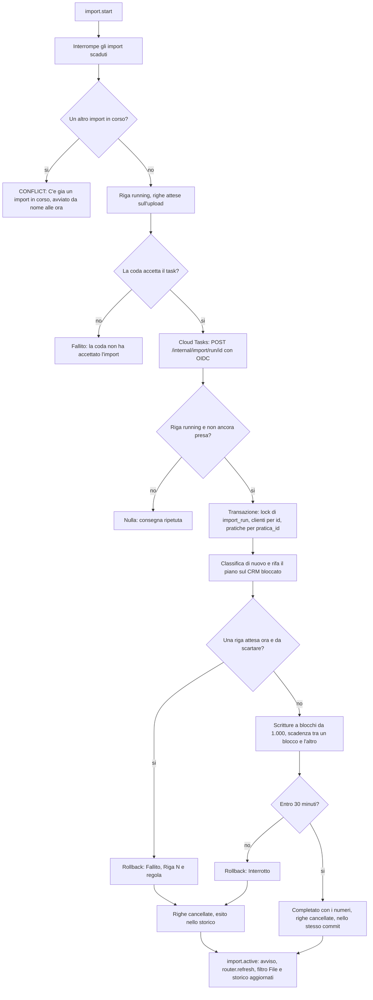

# Esecuzione di un import confermato

**Attore:** il sistema (backend Cloud Run e coda Cloud Tasks), per l'admin che ha confermato. **Innesco:** `import.start` risponde con il `runId` alla fine di [[domains/crm/flows/nuovo-import-con-anteprima]]. **Esito:** l'import è "Completato" con i numeri di quello che ha scritto, oppure "Fallito" o "Interrotto" senza aver scritto nulla. In ogni caso le righe temporanee si cancellano, l'esito resta nello storico e, se l'admin è ancora nel CRM, compare un avviso.

1. **Avvio.** `startImport` controlla che la coda ci sia: senza, l'admin legge "L'import non è disponibile su questo ambiente" (D13). Prima porta a "Interrotto" gli import rimasti in corso oltre i 30 minuti che nessuna transazione tiene (AC30).
2. **Un import alla volta.** Blocca l'upload dell'admin, classifica le righe e rifiuta subito una riga attesa che la classificazione scarta (AC12). Scrive la riga `running` di `import_run` e collega l'upload con le righe attese. Un secondo `running` fallisce sull'indice unico parziale, anche da un'altra istanza o con un doppio clic: l'admin legge "C'è già un import in corso, avviato da <nome> alle <ora>" e nulla è scritto (AC22, D7).
3. **Coda.** Il task va in Cloud Tasks (3 tentativi con backoff, una consegna alla volta, D1). Se la coda lo rifiuta, l'import è "Fallito" ("La coda dell'import non ha accettato l'import") e le righe si cancellano. Da qui chiudere la scheda, ricaricare o cambiare pagina non ferma l'import (AC20).
4. **Consegna.** Cloud Tasks chiama `POST /internal/import/run/:runId` sul backend con un token OIDC del service account della coda, audience uguale all'URL del servizio. La rotta risponde 200 anche quando l'import fallisce, così la coda ripete solo una consegna che non è arrivata. Senza configurazione risponde 503.
5. **Presa.** `executeImport` segna `claimed_at` in un commit a parte: un task consegnato di nuovo, o per un import che non è più in corso, non fa nulla (D7).
6. **Transazione.** Blocca la riga di `import_run` fino alla fine, poi clienti e pratiche del file nell'ordine di [[domains/crm/concepts/regola-dei-lock]]. Classifica di nuovo le righe e rifà il piano sul CRM bloccato: le righe non confermate restano fuori (D10). Una riga attesa che ora è da scartare (AC11, AC11b) fa fallire tutto, con un motivo che nomina riga e regola (AC19b). Un cliente o una pratica comparsi nel frattempo cambiano solo i numeri (AC23).
7. **Scritture.** A blocchi di 1.000 righe: clienti nuovi senza operatore, clienti da aggiornare con i soli valori non vuoti, pratiche nuove, pratiche esistenti, legami mancanti (AC34–AC38, [[domains/crm/concepts/riconoscimento-dei-clienti-nell-import]]). Nessun contatto e nessuna chat (AC39). Un codice cliente o una pratica creati da altri nel frattempo fanno fallire l'import sulla loro riga.
8. **Scadenza.** Prima di ogni blocco si controlla il tempo rimasto dai 30 minuti dell'inizio e `statement_timeout` torna pari a quel tempo (D8). Oltre la scadenza, rollback ed esito "Interrotto" ("L'import non è finito entro 30 minuti dall'inizio").
9. **Esito.** Con successo, "Completato" con i numeri e la cancellazione delle righe temporanee stanno nello stesso commit dei dati (D9). Dopo un rollback, "Fallito" o "Interrotto" si scrivono in una transazione a parte, che cancella anch'essa le righe. Il motivo non contiene valori delle righe: numero di riga e regola, o il codice di Postgres (AC29, AC31). Su un deadlock la transazione si ripete.
10. **Concorrenza.** Durante l'import gli operatori lavorano: una scrittura su un cliente o una pratica dell'import aspetta la fine e poi riesce, o scade senza salvare nulla a metà (AC27). La disattivazione di un operatore blocca le pratiche nello stesso ordine (D6).
11. **Pulizia.** Ogni upload ha un task `POST /internal/import/purge/:uploadId` a +1 ora (D14). Cancella le righe se nessun import le usa. Se l'import collegato è ancora vivo, la pulizia torna un minuto dopo la sua scadenza. Se l'import è rimasto in corso oltre la scadenza e nessuna transazione lo tiene (server fermato, OOM, deploy), lo porta a "Interrotto" e cancella le righe (AC30).
12. **Avviso.** Il provider nel layout della dashboard chiede `import.active` ogni 3 secondi, solo per gli admin e solo con un loro import in corso (D15). All'esito mostra un toast con i numeri o col motivo (AC21). Per un import completato, `router.refresh()` aggiorna Clienti, Pratiche e "Ultime Pratiche Aggiornate", e si aggiornano il filtro "File" e lo storico (AC26).

## [Source: IMPLEMENTATION-NOTES]

- Codice: `packages/server/src/services/import/` (`run.ts` avvio, esecuzione, scadenza e pulizia; `apply.ts` scritture; `lookup.ts` lettura e lock; `upload.ts` righe temporanee; `history.ts` storico; `queue.ts` e `live.ts` coda), rotte in `apps/api/src/import/`, verifica OIDC in `apps/api/src/oidc.ts` (la stessa dei cron), avviso in `src/app/_context/ImportStatus.tsx`.
- Deviazione (T9): clienti e pratiche nuovi si inseriscono con `ON CONFLICT DO NOTHING RETURNING`, così la transazione non si rompe su un 23505 e la riga in conflitto si trova da `newRows`. Gli aggiornamenti usano `jsonb_to_recordset`, un parametro per blocco.
- Deviazione (T9b): "Assegna" della pagina Pratiche (`bulkAssignPractices`) è stato tolto da `dev` (#83), quindi di D6 resta solo la disattivazione.
- Deviazione (T10b): `activeImport` dà l'ultimo import dell'admin, anche finito, perché l'avviso deve leggere l'esito dopo la fine. La conferma passa il `runId` all'avviso, così arriva anche per un import che finisce prima della prima domanda.
- Coda (D13): Cloud Tasks con l'API REST e il token del metadata server quando ci sono `IMPORT_QUEUE`, `IMPORT_OIDC_AUDIENCE` e `IMPORT_OIDC_SERVICE_ACCOUNT`; in processo solo in locale (mai in prod, su Cloud Run o su Vercel); spenta altrove. Le variabili si leggono con `Config` di Effect e non entrano in `@mito/env`.
- Prestazioni (AC25): 12,0 s di mediana su 20.000 righe, attraverso procedure e coda in processo su Postgres 16 (`import.perf.pg.test.ts`, solo con `PERF=1`).
- Correzioni della review ([[specs/crm/import-pratiche/REPORT]], `ac3ec7e`, `38e4248`): la pulizia che interrompe un import scaduto e torna se è vivo (prima le righe restavano fino al prossimo import); un solo lock ordinato sui clienti (prima due round fuori ordine, con deadlock contro la disattivazione); `statement_timeout` reimpostato prima di ogni passo; Sentry non riceve più il corpo delle richieste. In `83486bb`: il nome del file salvato su clienti e pratiche segue di nuovo `parseFileName` (il BLOCKER).
- ⚠ Non provato fuori dal container: la coda Cloud Tasks vera e il token OIDC di Google, dopo `setup-import-queue.sh` (T12a) e la prova su staging (T12b). Rami corretti ma senza test: retry sul deadlock, guardia di `endRun`, `FOR UPDATE` di upload e pulizia, pratica creata da altri durante l'import ([[tech-debt/crm/import-pratiche]]).
