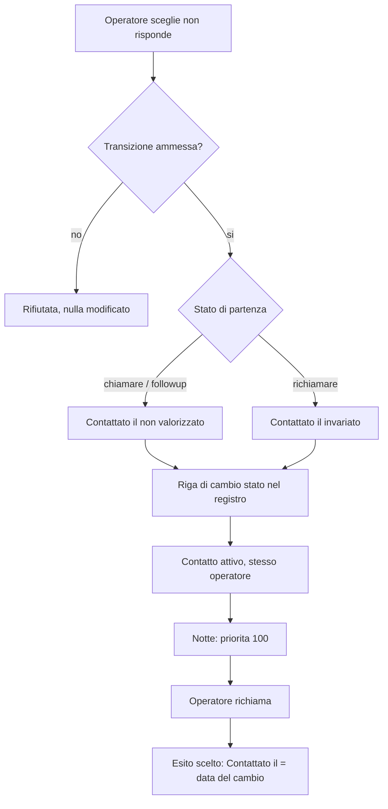

# Esito "non risponde" e ritorno in coda

**Attore:** operatore. **Innesco:** chiama un contatto che non risponde e cambia lo stato a mano, dalla lista o dal dettaglio. **Esito:** il contatto resta attivo e in coda, e la chiamata è tracciata come non risposta.

1. L'operatore apre il selettore dello stato: `non risponde` è tra gli stati del selettore e dei filtri di Contatti (AC1).
2. Il cambio è ammesso da ogni stato da cui oggi si può scegliere un esito; da `non risponde` verso `chiamare` o `followup` è rifiutato come transizione non ammessa, senza modificare nulla (AC1b).
3. Da `chiamare` o `followup`: "Contattato il" non viene valorizzato, il contatto resta attivo e assegnato allo stesso operatore (AC2). Da `richiamare`: "Contattato il" resta quello di prima (AC2b).
4. Si scrive una riga di cambio stato nel registro (AC2): è la base del conteggio in [[domains/crm/concepts/chiamata]].
5. Dopo il ricalcolo notturno delle priorità, senza priorità personalizzata il contatto ha priorità 100: sotto `chiamare` (120), sopra tutti gli altri stati (AC4). Non c'è ritorno automatico dopo un tempo: resta in coda da subito.
6. Su un contatto `non risponde` "Imposta richiamo" non è disponibile, come su `chiamare` (AC5).
7. Da `non risponde` a un esito il contatto si chiude come da `chiamare`: "Contattato il" prende la data del cambio (AC3). Da `non risponde` si può anche tornare a `nessuno`.

## [Source: IMPLEMENTATION-NOTES]

- Il divieto `non risponde` → `chiamare` (AC1b) è stato aggiunto in PR #61 (T0) insieme al test di AC2b; AC1–AC5 sono coperti da #57 e #61.
- Codice: `packages/domain/src/contact/status.ts` (`isAllowedChange`, `selectableStates`).

Concetti: [[domains/crm/concepts/stato-del-contatto]], [[domains/crm/concepts/chiamata]]. Flusso collegato: [[domains/crm/flows/export-chiamate-per-operatore-admin]].
