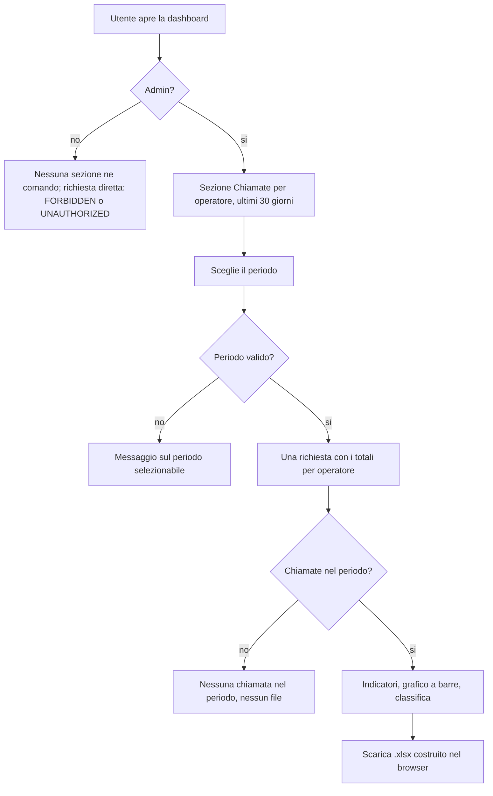

# Export chiamate per operatore (admin)

**Attore:** admin. **Innesco:** apre la dashboard. **Esito:** vede indicatori e grafici delle chiamate di ogni operatore per un periodo e, se vuole, scarica un foglio Excel con gli stessi numeri.

1. Un non admin non vede il comando né la sezione (AC6, AC20); una richiesta dei dati fatta da lui è `FORBIDDEN`, senza sessione `UNAUTHORIZED`, e non restituisce dati (AC7, AC8).
2. L'admin vede nella dashboard la sezione propria "Chiamate per operatore", con periodo suo (non quello di "Analisi Andamento"); il periodo di partenza sono gli ultimi 30 giorni, oggi incluso.
3. Sceglie il periodo secondo [[domains/crm/concepts/periodo-dell-export]]; il periodo vale per indicatori, grafici e file (AC16). Se inizia prima del 15/09/2026 compare "Dati completi solo dal 15/09/2026" (AC11b). Un periodo non selezionabile mostra un messaggio e non fa richieste.
4. Una sola richiesta dà, per ogni operatore con almeno una chiamata, nome, cognome e i quattro totali, ordinati per chiamate decrescenti (a parità cognome e nome), più la riga dei totali (AC9, AC12). La risposta non contiene dati dei clienti (AC22). Conteggio: [[domains/crm/concepts/chiamata]].
5. Senza chiamate nel periodo: "Nessuna chiamata nel periodo" e nessun file (AC14).
6. Con chiamate: quattro indicatori con i totali (AC16), grafico a barre con risposte e non risposte impilate per operatore (AC17), classifica per quota di appuntamenti sulle risposte, decrescente, 0% senza risposte (AC18). Gli stessi numeri sono nel file (AC19).
7. Il comando di scarico genera nel browser un .xlsx con un foglio, una riga per operatore e la riga "Totale"; colonne "Operatore", "Chiamate effettuate", "Risposte", "Appuntamenti fissati", "Non risposte"; nome `chiamate_AAAA-MM-GG_AAAA-MM-GG.xlsx` (AC13).
8. L'export "default" (clienti e pratiche) e l'elenco delle chiamate chiuse non esistono più (AC15).

## [Source: IMPLEMENTATION-NOTES]

- Deviazione: la sezione è un blocco proprio della dashboard (`CallsSection`), non dentro `AdminDataSection`, perché ha un periodo suo.
- Periodo di default: ultimi 30 giorni (`defaultPeriod`). `xlsx` si carica solo al click.
- Il file nasce nel browser dai numeri già in pagina: non passa dallo storage (nota tecnica della spec).
- Se la richiesta fallisce compare un messaggio con "Riprova"; `now` è riletto a ogni render, così oltre la mezzanotte il nuovo giorno è selezionabile (review [[specs/crm/export-chiamate/REPORT]]).
- Permessi: `adminProcedure` dalla [PR #101](https://github.com/omardeangelis/mito-micro-services/pull/101) (prima `adminSessionProcedure`, tolta). Un utente senza riga operatore, anche un admin, riceve `BAD_REQUEST`: per la regola "ogni utente è un operatore" ([[domains/crm/concepts/operatore]]) è un'anomalia.
- Codice: `packages/server/src/api/routers/export/GET/callStats.ts`, `packages/server/src/services/export/callStats.ts`, `src/app/dashboard/_components/export/` (`CallsSection`, `AdminExportSection`, `ExportKpis`, `ExportCharts`, `ExportDownload`), `src/lib/export/callStatsWorkbook.ts`.
- Prestazioni (AC21): mediana 22 ms su 100.000 righe, nessun indice necessario.
