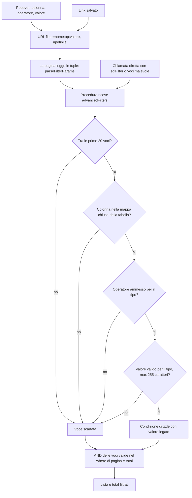

# Filtro avanzato di Clienti e Pratiche

**Attori:** operatore (`OPERATORE`) o amministratore (`ADMIN`); un chiamante diretto della procedura come caso avverso. **Innesco:** sceglie colonna, operatore e valore nel popover dei filtri di Clienti o Pratiche, oppure apre un link salvato con `filter=`. **Esito:** la lista e il suo `total` contano solo le righe che rispettano le voci valide; le voci non valide si scartano in silenzio, e nessun SQL del client arriva al database.

1. Nel popover l'utente sceglie una colonna fra quelle della tabella e un operatore fra quelli che il tipo della colonna ammette: su testo ed enum solo `=`, su numeri e date `=`, `>`, `<`, `>=`, `<=`. Per un enum il valore è un Select, per una data c'è il segnaposto `aaaa-mm-gg` (vedi [[domains/crm/concepts/colonne-filtrabili]]).
2. Il popover scrive il filtro nell'URL come `filter=nome:operatore:valore`, ripetibile. È la forma di prima: i link salvati continuano a funzionare (AC9).
3. La pagina (`CustomerTableSection.tsx`, `pratiche/page.tsx`) legge le tuple con `parseFilterParams` e le manda come dati, `advancedFilters: {field, op, value}[]`. Una tupla con una parte mancante o vuota non è un filtro; di `a:eq:10:30` restano le prime tre parti.
4. La procedura (`customer.getAllCustomers`, `pratiche.getAllPratiche`) riceve le voci. `sqlFilter` non è più nell'input: un frontend vecchio che lo manda ancora non ottiene filtri, e niente viene eseguito (AC10).
5. Il traduttore (`advancedFiltersWhere`) considera solo le prime 20 voci (D17).
6. La colonna si cerca nella mappa chiusa della tabella: Clienti solo colonne di `customers`, Pratiche solo di `practices`. Una colonna fuori mappa, comprese `state` e `closed_at` di `task` nei link vecchi di Clienti, si scarta (AC7, AC8).
7. L'operatore deve essere fra quelli ammessi per il tipo; un operatore scritto a mano, come `comune:gt:M`, si scarta.
8. Il valore si convalida per tipo (vedi [[domains/crm/concepts/filtro-avanzato]]). Un valore oltre 255 caratteri, una data malformata, un intero fuori range, un testo vuoto o con il byte NUL si scartano.
9. Ogni voce valida diventa una condizione drizzle (`eq`, `gt`, `lt`, `gte`, `lte`, `ilike` con `containsPattern`), con il valore come parametro legato (AC5). Le voci valide vanno in AND nello stesso `where` della pagina e del `total`; in Pratiche anche nei due rami della `union`.
10. Una voce scartata non dà errore e non cambia le altre: la lista resta quella delle voci valide (AC8). Con nessuna voce valida la lista è intera.

## Casi avversi

- **Chiamata diretta** con un frammento SQL (`NOT EXISTS (SELECT 1 FROM "mito-deutsche_user")`, `1=1) OR (1=1`), come `sqlFilter` o come voce: lista e `total` restano quelli della stessa chiamata senza il frammento (AC2). Prima della riforma l'iniezione girava con il ruolo owner del database.
- **Apice, `%`, `_`, `\`** in un valore di testo: sono caratteri letterali, non chiudono la stringa e non fanno da jolly (AC4).

## [Source: IMPLEMENTATION-NOTES]

- Il tipo della colonna si legge da `columnType`, non da `dataType`: in drizzle 0.45.4 `numeric` ha `dataType "string"`, e prima `=` su un decimale finiva in `ilike` su un `numeric` ed era un errore del database. Ora è uguaglianza esatta (D16).
- Le date si legano come testo `aaaa-mm-gg`, senza l'encoder della colonna: Postgres le converte nel fuso della sessione (`Europe/Rome`), come il letterale di prima (D11).
- `getAllPratiche` è passata a Effect a comportamento invariato fuori dai filtri (AC12), provata da test di caratterizzazione scritti prima.
- Rispetto a prima cambiano per scelta alcuni risultati: l'elenco è in [[domains/crm/concepts/filtro-avanzato]] e nel §13 di [[specs/crm/filtri-sql-sicuri/PLAN]].
- Codice: `packages/domain/src/filters/advanced.ts` (mappe, tipi, operatori, lettura dell'URL), `packages/server/src/api/routers/utils/advancedFilters.ts` (traduttore), `src/components/custom/table/PopoverFilter.tsx` (popover).

## [Source: REPORT]

- Review SHIP, impatto critical, 7 passaggi: nessun percorso per SQL del chiamante in una delle cinque query, parametri legati visti sul driver di produzione. Rilievi residui in [[tech-debt/crm/filtri-sql-sicuri]]. Vedi [[specs/crm/filtri-sql-sicuri/REPORT]].

Concetti: [[domains/crm/concepts/filtro-avanzato]], [[domains/crm/concepts/colonne-filtrabili]].
