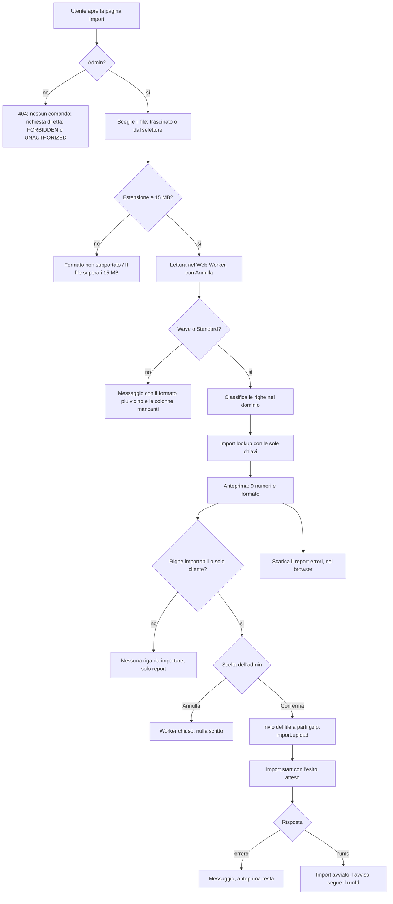

# Nuovo import con anteprima (admin)

**Attore:** admin. **Innesco:** apre la pagina "Import" dal menu o dal pulsante "Nuovo import" della dashboard. **Esito:** l'import parte con le righe che l'anteprima ha mostrato, oppure l'admin annulla senza che nulla sia scritto. Da lì in poi vale [[domains/crm/flows/esecuzione-di-un-import-confermato]].

1. **Chi entra.** La voce "Import" del menu e il pulsante "Nuovo import" compaiono solo agli admin (AC1, AC28). Per un operatore la pagina risponde 404. Ogni procedura `import.*` chiamata da un non admin è `FORBIDDEN` prima di leggere l'input, senza sessione `UNAUTHORIZED` (AC2, AC3).
2. **Scelta del file.** L'admin lo trascina nell'area o lo sceglie dal pulsante (AC5). Prima di leggere si controllano estensione (`.xlsx`, `.xls`, `.csv`) e dimensione (15 MB); i messaggi sono "Formato non supportato: carica un file Excel o CSV" e "Il file supera i 15 MB".
3. **Lettura nel worker.** Il file si legge in un Web Worker modulo, con la pipeline di oggi (`XLSX.read` → `sheet_to_csv` → papaparse, D2): le celle che arrivano alla conversione sono quelle di oggi (AC32). Durante la lettura c'è "Annulla", che termina il worker (AC17, AC18). Alla pagina arrivano solo numeri, numeri di riga e il corpo compresso: le righe restano nel worker.
4. **Formato.** Il file è Wave o Standard per le colonne che ha ([[domains/crm/concepts/riga-dell-import]]). Se non è nessuno dei due, il messaggio nomina il formato con più colonne in comune e quelle che mancano; con la prima riga vuota, "Le intestazioni devono essere nella prima riga" (AC6). Oltre 50.000 righe: "Il file ha più di 50.000 righe".
5. **Classificazione.** Ogni riga diventa importabile, solo cliente o scartata con tutti i suoi motivi, con il codice di `@mito/domain` che il server rifà (AC8–AC13, AC12).
6. **Lettura del CRM.** Il worker manda a `import.lookup` solo le chiavi (codici fiscali, partite IVA, codici cliente, ID pratica). La procedura legge clienti, pratiche e legami esistenti e non scrive nulla (D3, AC7). Con le risposte, `planRows` calcola chi è nuovo, chi si aggiorna e AC11b ([[domains/crm/concepts/riconoscimento-dei-clienti-nell-import]]).
7. **Anteprima.** Mostra formato, righe del file, importabili, solo cliente, scartate, clienti nuovi e da aggiornare, pratiche nuove e da aggiornare, legami nuovi (AC7). Senza righe importabili né solo cliente compare "Nessuna riga da importare" e la conferma non c'è (AC16).
8. **Report errori.** Con almeno una riga scartata si scarica dall'anteprima: un .xlsx costruito nel browser, foglio "Errori", colonne "Riga", "Errori" (motivi separati da "; ") e poi quelle del file con i valori che Excel mostra, nome `errori_import_<file>_<AAAA-MM-GG>.xlsx` (AC13, AC14, D16). Non va nulla al server né allo storage (AC15).
9. **Annulla.** Termina il worker e torna alla scelta del file. Non scrive nulla (AC17).
10. **Conferma.** Le righe partono una volta sola: compresse in gzip, a parti da 1,5 MB, una richiesta alla volta (`import.upload`), poi `import.start` con l'esito atteso, cioè i numeri delle righe che l'anteprima dava per importabili o solo cliente (D3, D10). Le chiamate `import.*` passano da un link senza batch e non finiscono in console (D12, AC31). Durante l'invio la pagina dice "Invio del file… Non chiudere la scheda finché l'import non parte": chiudere la scheda in quei secondi annulla un import che non è ancora partito.
11. **Risposta.** Con il `runId` la pagina dice "L'import di X è in corso: puoi usare il resto del CRM, ti avviso quando finisce", e passa il `runId` all'avviso di fine. Un errore su cui l'admin può agire (`BAD_REQUEST`, `CONFLICT` come "C'è già un import in corso, avviato da <nome> alle <ora>", `PRECONDITION_FAILED`, `NOT_FOUND`) mostra il messaggio del server; gli altri un messaggio generico. L'anteprima resta (AC22).
12. **Accessibilità.** Tutto si fa da tastiera; lettura, anteprima, invio e avvio sono annunciati ai lettori di schermo, e il focus segue i passi (AC41).

## [Source: IMPLEMENTATION-NOTES]

- Codice: `src/app/dashboard/import/` (`page.tsx`, `_components/NewImport.tsx`, `useNewImport.ts`, `ImportPreview.tsx`), `src/lib/import/` (`read.worker.ts`, `readImportFile.ts`, `parseWorkbook.ts`, `errorReport.ts`, `upload.ts`), dominio in `packages/domain/src/import/`, procedure in `packages/server/src/api/routers/import/`.
- Deviazione (T14): il messaggio per un file oltre le 50.000 righe è nell'anteprima, non alla conferma. Un errore del worker si mostra senza il suo motivo, che potrebbe contenere valori delle righe (AC31).
- Deviazione (T10a): `startImport` rifiuta subito una riga attesa che non si può importare, così l'admin vede l'errore alla conferma invece che nello storico.
- Le parti sono da 1,5 MB (`UPLOAD_PART_BYTES`), non da 2 MB come diceva D3.
- Correzioni della review ([[specs/crm/import-pratiche/REPORT]], `ace44aa`): focus sui passi; due clic su "Conferma" fanno un solo import; il report che non si crea dà "Il report errori non si è potuto creare: riprova" e il suo link vive 40 s; lo status non ripete i messaggi già annunciati dall'alert. In `83486bb`: gli spazi intorno ai nomi delle colonne non rompono più la lettura.
- Rinviati nel debito ([[tech-debt/crm/import-pratiche]]): un CSV in UTF-8 senza BOM arriva con le intestazioni rotte; un file lasciato fuori dall'area durante la lettura fa navigare la scheda; AC18 (anteprima in 10 s nel browser) non è misurato (T12b).
