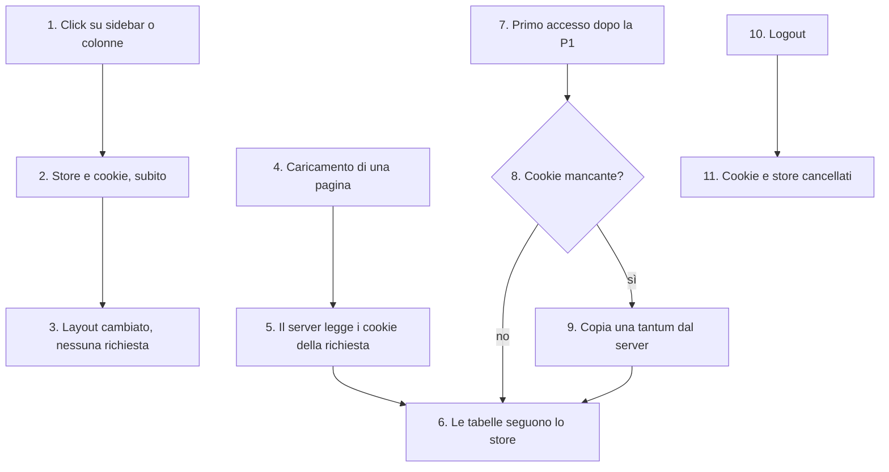

# Preferenze di layout nel browser

Come il gestionale tiene la sidebar chiusa e le colonne nascoste di Clienti, Pratiche e Contatti. Le scelte stanno in cookie del browser, scritti dal client. Nessuna scelta di layout fa una richiesta al server.

- **Attore:** qualunque utente con una sessione.
- **Inizio:** un click sulla sidebar o sul menu delle colonne, il caricamento di una pagina, il primo accesso dopo il rilascio, il logout.
- **Esito:** il layout cambia subito, e alla visita successiva la pagina parte con le scelte fatte in quel browser.

Fonte: [[specs/crm/gestione-operatori/SPEC]] (AC31–AC35, D9). Implementato nella PR P1. La PR P2 è un passo futuro (ultima sezione).

## Perché è fatta così

- **Prima ogni scelta passava dal server.** Ogni click faceva `POST /api/user/preferences`, e la sidebar e le colonne di Clienti e Pratiche cambiavano solo dopo la risposta. Contatti cambiava subito ma poi faceva `router.refresh()`, che rilanciava la query dei contatti. In lettura, Clienti e Pratiche chiamavano `getUserPreference` dopo la query dei dati, in serie. Tutto questo per una scelta che non serve a nessun altro.
- **Cookie, non localStorage o IndexedDB.** Clienti, Pratiche e Contatti sono server component: il server deve sapere quali colonne nascondere al primo render. localStorage e IndexedDB il server non li vede. Un cookie resta nel browser come localStorage, ma viaggia con la richiesta della pagina e il server lo legge senza query. IndexedDB è asincrono e pensato per molti dati: per 4 chiavi piccole costa più di quello che dà.
- **Un cookie per chiave.** Clienti ha circa 32 colonne: una lista di id resta sotto 1 KB, lontano dai 4 KB di un cookie.
- **Costo accettato:** ogni browser ha le sue preferenze. Non si sincronizzano fra dispositivi.
- **Il giorno che il frontend sarà solo client**, fuori da Next.js, il cookie resta leggibile da `document.cookie`, e la scelta non va rifatta.

## Diagramma

## Passi

### Una scelta di layout

1. **L'utente apre o chiude la sidebar, o mostra o nasconde una colonna** di Clienti, Pratiche o Contatti.
2. **Lo store zustand e il cookie si aggiornano insieme**, sul client. Ogni setter scrive solo il suo cookie (`path=/`, `SameSite=Lax`, scadenza 1 anno). Nessuna `fetch`, nessun `router.refresh()`.
3. **Il layout cambia subito.**

### Il caricamento di una pagina

4. **L'utente apre Clienti, Pratiche o Contatti.**
5. **Il server component legge i cookie della richiesta** (`cookies()` di `next/headers`) e passa le colonne nascoste alla tabella. Le pagine non chiamano più `getUserPreference` per le colonne. Un cookie illeggibile (encoding, JSON, tipo sbagliato) vale come assente. Una lista che nomina colonne non più esistenti non nasconde nulla.
6. **Le tabelle prendono lo stato dallo store del client**; la prop del server vale solo per il primo render. Così, tornando su una pagina entro i 30 secondi della router cache, si vedono le colonne scelte per ultime e non quelle del render in cache.
   - **Invariante del rendering di oggi** (review della P1): niente sotto `UserPreferenceProvider` è reso dal server. Il provider mostra lo scheletro finché carica `getUserPreference`, che non è prefetchata. La lettura dei cookie della richiesta serve quindi da seme per le tabelle. Se un giorno il dashboard venisse reso dal server, lo store andrebbe seminato dai cookie della richiesta, o sidebar e chiavi copiate non combacerebbero all'idratazione.

### Il primo accesso dopo il rilascio della P1

7. **Il provider legge `getUserPreference`**, che serve ancora per `role` e `operatorId` e, fino alla P2, restituisce anche le preferenze salvate sul server.
8. **Per ogni chiave controlla se c'è già il cookie.**
9. **Copia una tantum:** se il cookie manca, lo scrive con il valore del server, dopo averne controllato il tipo. Un cookie che c'è già non si sovrascrive. La copia avviene prima che le tabelle si montino, così partono già con le colonne copiate.
   - Il vecchio localStorage `userPreference-storage` non si legge più. Un valore della sidebar lì più nuovo di quello del server si perde una volta. Accettato: è solo layout.
   - Le colonne di Pratiche non si copiano: il vecchio codice le salvava sotto la chiave sbagliata, e il server non le ha mai tenute.

### Il logout

10. **L'utente esce** ("Esci dal gestionale", `logout` di `LogoutFloatingButton`).
11. **Si cancellano i 4 cookie e lo store**, ruolo e operatore compresi. Chi entra dopo nello stesso browser parte dal layout di default.
    - **Caso accettato:** una sessione scaduta senza logout lascia i cookie al prossimo utente di quel browser. Vede solo quali colonne erano nascoste, nessun dato.
    - Ruolo e operatore vengono sempre dalla sessione, mai dal browser: un altro login nello stesso browser non eredita quelli di prima.

## Passo futuro: PR P2 (non ancora fatta)

Questa parte non è lo stato attuale. Oggi la route `/api/user/preferences` e le 4 procedure `update*` esistono ancora, senza più chiamanti nel client.

- **Quando:** almeno 2 settimane dopo il rilascio in prod della P1 su Vercel. La P1 deve essere in prod prima che la P2 arrivi al backend (AC35).
- **Che cosa toglie lato server (AC34):** le 4 procedure `update*` e i loro tipi esportati; la route `/api/user/preferences` e la sua voce in `apps/api/src/rest.ts`; il campo `preferences` dalla risposta di `getUserPreference`, che resta per `role` e `operatorId`; il test `user/_test/contactPreference.db.test.ts`. Con il campo se ne va anche la copia una tantum del provider, che non ha più niente da copiare.
- **Una scheda rimasta aperta con il codice vecchio** che chiama una `update*` già tolta non si rompe: la scelta resta a schermo e l'errore va solo in console.
- **La colonna `users.preferences` resta.** Dopo la P2 nessuno la legge, ma toglierla è una migrazione distruttiva: è il debito TD1 di [[chore/migrazione-effect]] §7.

## Riferimenti

- Spec: [[specs/crm/gestione-operatori/SPEC]]; note: [[specs/crm/gestione-operatori/IMPLEMENTATION-NOTES]]; review: [[specs/crm/gestione-operatori/REPORT]] (PR P1).
- Codice: `src/lib/preferences/{cookies,server}.ts`; `src/store/userPreferences.ts`; `src/store/context/UserPreferenceContext.tsx`; le tabelle di Clienti, Pratiche e Contatti; `LogoutFloatingButton.tsx`.
- Concetto: [[domains/crm/concepts/preferenze-di-layout]].
