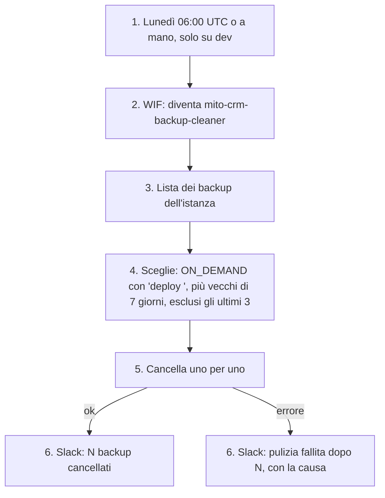

# Pulizia dei backup di staging

I backup on-demand di Cloud SQL non scadono da soli. Un workflow GitHub (`.github/workflows/cleanup-staging-backups.yaml`) cancella quelli presi dal deploy quando non servono più.

- **Attore:** il workflow, come service account `mito-crm-backup-cleaner`; una persona può lanciarlo a mano ("Run workflow" su `dev`).
- **Inizio:** ogni lunedì alle 06:00 UTC, o `workflow_dispatch`.
- **Esito:** un messaggio in `#deploy` con quanti backup ha cancellato, o perché è fallito.

1. Il job gira solo su `refs/heads/dev`.
2. Il provider WIF di staging accetta solo questo repository su `dev`; il service account della pulizia accetta solo questo workflow (`job_workflow_ref`). Il deployer non può cancellare backup, e la pulizia non può crearne.
3. `gcloud sql backups list` sull'istanza `mito-crm-staging`.
4. `backupsToDelete` (`apps/api/gcp/lib/backupsToDelete.ts`) tiene fuori i backup automatici e quelli fatti a mano (descrizione diversa da `deploy …`). Dei backup del deploy tiene sempre i 3 più recenti e cancella gli altri più vecchi di 7 giorni.
5. Cancella in ordine dal più vecchio.
6. Un messaggio sullo stesso canale dei deploy. Su errore la run diventa rossa.
